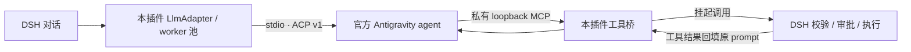

<div align="center">

# Antigravity ACP for DSH

**在 DSH 里使用 Antigravity 模型，工具仍交给 DSH。**

接入 Google 官方 Antigravity ACP agent，在同一个对话界面选择模型、查看额度、预热连接。

[](https://www.npmjs.com/package/dsh-bundle-antigravity-host)
[](LICENSE)
[](#兼容性与验证范围)

[快速开始](#快速开始) · [功能亮点](#功能亮点) · [配置参考](docs/configuration.md) · [排障](docs/reference.md#排障) · [更新记录](docs/changelog.md)

</div>

---

> **0.1.24**：新增默认双 worker 并发、登录后模型发现、原生图片输入与可取消连接；完善工具续轮、代理和运行目录回收。类型检查、**33 个文件 / 515 项测试**与构建通过。真实上游生成、图片识别、安装后的 Desktop GUI 和跨平台实机验收尚未完成。[查看本次更新与限制](docs/changelog.md#0124--2026-10-22)。

## 快速开始

```console
dsh plugin --profile web add dsh-bundle-antigravity-host
```

`web` 是示例 Profile，请替换为实际目标。**DSH NEXT Desktop 使用目标桌面壳提供的 DSH Desktop CLI**；不要用独立 npm 公共 CLI 管理保留的 `desktop` Profile。[安装与更新说明](docs/reference.md#安装与更新)

1. **安装并启用**：按部署方式重载或重启，让 Host 与 Client 一起生效；只刷新页面不保证 Host 已升级。
2. **打开「设置 → Antigravity ACP」**：需要代理时先配置并保存，再点击 **连接 / 登录 ACP**。插件优先复用已有 ACP 登录态，或导入本机已登录的官方 CLI 登录态；必要时才进入官方浏览器授权。成功建会话后读取模型目录，不需要先发送聊天。
3. **选择模型，开始对话**：提供商名称为 **Antigravity (ACP)**，路由 ID 为 `antigravity-acp`。模型选择器左侧出现额度药丸和预热按钮；工具调用继续走 DSH 的校验、审批与执行。

**额度或 AI Credits 没有显示？** ACP 连接与 CLI 登录是两条链路。额度查询优先使用已登录的官方 `agy`，AI Credits 仅从 CLI 读取；ACP 登录成功不代表 CLI 也已登录。[登录态与数据来源](docs/reference.md#登录态与额度来源)

## 功能亮点

### 多个对话，不再共用一个待审批回合

默认按需启动最多 **2 个独立 worker**，可配置为 1–4 个。一个会话等待工具审批时，其它会话可使用空闲 worker；同一工具回合的结果仍回到原 worker。容量用满后排队，支持取消，默认等待上限 120 秒，主对话优先于排队中的后台标题。

这不是无限并发，也不保证上游账户额度随 worker 数增加。[并发与续轮边界](docs/reference.md#并发与工具续轮)

### 先连接、拿目录，再开始聊天

设置页区分 **立即预热** 与 **连接 / 登录 ACP**：前者准备连接但不创建会话，后者验证会话并读取模型目录，两者都不发送聊天 prompt。目录使用缓存即时显示，支持主动刷新、选择默认模型或手填模型 ID；目录外 ID 明确标记为未验证。

模型家族与思考强度分开：选择家族，再由 DSH 的思考强度菜单路由到官方对应档位。不硬编码账号应当拥有的模型清单。[模型与请求项映射](docs/reference.md#模型目录与请求项)

### 图片传给模型，不只传一段文字说明

在 **宿主附件服务可用且上游声明 image capability** 时，当前消息、历史消息和工具返回的图片通过真实图片内容传入。支持 PNG、JPEG、WebP 与 GIF；只读取宿主附件，不自行抓取图片 URL。已被宿主卸载的图片会明确说明未发送像素。

这是输入能力，不包含图片生成、音频或视频；真实图片识别效果尚未实机验收。[多模态限制](docs/reference.md#图片输入)

### 额度、余额与连接状态，就在对话旁

- **额度药丸**：随当前模型切换对应额度组；展开查看三个组的窗口、剩余百分比、重置时间与缓存状态。
- **AI Credits**：与套餐额度独立展示、独立缓存与报错；未知不是零，不会自动开启 Credits 付费回退。
- **预热与诊断**：药丸可直接预热；设置页显示连接阶段、排队、进程复用，以及建会话、首块和工具续轮耗时。
- **设置不丢草稿**：后台刷新保留未保存字段，外部冲突明确提示；遵守宿主只读状态。

## 它如何工作



本包是 **Host + Web Client bundle**：Host 注册模型 provider、管理官方进程和工具桥，Client 提供设置页与额度药丸。不修改 DSH Core，也不把官方 CLI 包装成聊天接口；CLI 仅用于只读模型目录、额度与余额查询。

**它不是直接的 Gemini 模型 API。** 普通新用户回合会创建 ACP 会话并重放完整 DSH 历史；工具续轮才复用同一 prompt。角色消息、采样控制、延迟与计费不能视为和原生 API 相同。

## 使用前，先知道这些边界

| 边界 | 当前行为 |
|---|---|
| 工具与权限 | AGY 内置工具、ACP fs / terminal 关闭；只允许已识别的私有桥请求进入 DSH，`allow_once` 不等于绕过 DSH 审批。协议约束**不是 OS 沙箱**。 |
| 登录材料 | 插件可能读取 CLI 登录文件，并为官方 ACP 写入 / 更新本机凭据文件；这些文件不是加密凭据库，Windows 访问保护依赖目录 ACL。 |
| 官方程序 | 按需从 `https://dl.google.com` 下载，拒绝重定向并检查 ZIP 路径；官方未提供校验和，不宣称签名验证通过。默认 server 版本为 **1.4.0**，不跟随 registry 自动升级。 |
| 模型参数 | `reasoningEffort` 映射官方档位；`maxTokens` 忽略；显式 `temperature` / `stop` 返回 `UNSUPPORTED_OPTION`。 |
| 数据可信度 | 缓存、失败、缺字段和未知分别标记；额度与余额仅供参考，不是计费依据。 |
| 版本与测试 | 宽 peer 范围是安装条件，不是全部 Core / 平台版本实机兼容证明；隔离测试不替代真实账号与 GUI 验收。 |

## 兼容性与验证范围

| 项目 | 当前声明 / 证据 |
|---|---|
| Node.js | `>=22.19` |
| DSH Core peer 范围 | `>=0.2.0-rc.1 <0.2.1-0 \|\| >=0.2.1-0 <0.3.0-0`，适用于所声明的三个 `dsh-*` peer |
| 开发契约基准 | `dsh-llm` / `dsh-subprocess` / `dsh-typert-protocol` / `dsh-attachment` **0.2.1-alpha.4**，Cordis **4.0.5-alpha.2** |
| 上游协议 | ACP **v1**；SDK **1.4.0** 与默认 server **1.4.0** 是两个独立版本 |
| 本次本地验证 | 类型检查、33 个文件 / 515 项隔离测试、构建 |
| 尚未覆盖 | 0.1.24 安装后的 Desktop GUI、真实上游生成与图片识别、非 Windows 实机 |

宿主附件服务是可选依赖，缺少时仍可文本聊天，但不声明图片能力。安装准入、开发类型检查和真实运行兼容性分别看待。[完整声明与验证方法](docs/development.md)

## 文档导航

| 你想做什么 | 文档 |
|---|---|
| 安装、连接、查看额度或排查错误 | [使用与技术参考](docs/reference.md) |
| 调整并发、超时、模型、代理或二进制位置 | [完整配置与环境变量](docs/configuration.md) |
| 查看 0.1.24 更新、迁移注意与剩余限制 | [更新记录](docs/changelog.md) |
| 构建、测试、打包或维护 npm 发布流程 | [开发、验证与发布](docs/development.md) |

## 许可与反馈

本插件采用 [MIT License](LICENSE)。Google Antigravity 官方程序是独立下载的第三方软件，不随本包再分发；本插件并非 Google 官方产品。

遇到问题请[提交 Issue](https://github.com/KouzakiUmi/dsh-antigravity-acp/issues)，附插件版本、**实际 DSH Core 版本**、操作系统、操作步骤和已脱敏错误码。不要附 token、Cookie、完整 OAuth URL、代理密码或凭据文件。
