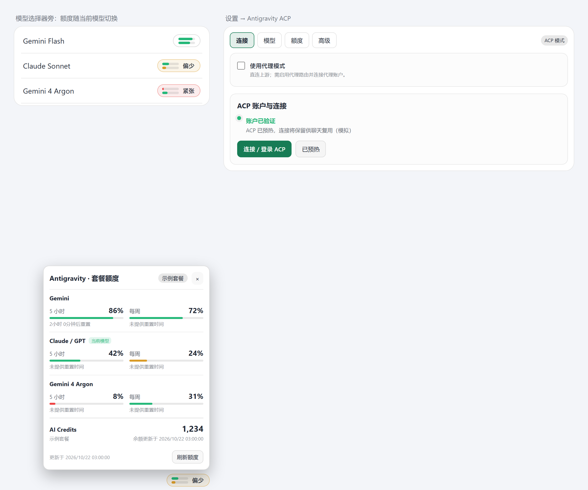
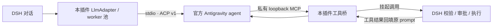

<div align="center">

# Antigravity ACP for DSH

**在 DSH 里使用 Antigravity 模型，工具仍交给 DSH。**

接入 Google 官方 Antigravity ACP agent，在同一个对话界面选择模型、查看额度、预热连接。

[](https://www.npmjs.com/package/dsh-bundle-antigravity-host)
[](LICENSE)
[](#兼容性与验证范围)

[快速开始](#快速开始) · [功能预览](#功能预览) · [功能亮点](#功能亮点) · [配置参考](docs/configuration.md) · [排障](docs/reference.md#排障) · [更新记录](docs/changelog.md)



</div>

---

> **0.1.37 · 界面细节修正**：未开启 CLI 积分查询时，额度详情与设置页不再显示 AI Credits 区块；开关已开但 CLI 缺失等故障仍显示便于排查。删除药丸详情与设置页共用区块底部的账户归属说明；设置页保存栏改为与其它面板一致的圆角面板样式，sticky 常驻逻辑不变。类型检查、**44 个文件 / 804 项测试**与构建通过。[查看更新与限制](docs/changelog.md#0137--2026-11-04)

> **0.1.36 · 紧凑设置与账户隔离**：设置页改为连接 / 模型 / 额度 / 高级分页，无修改时隐藏保存横幅；模型使用紧凑列表，支持搜索、筛选、批量启停与完整详情。修复 ACP 复用会话沿用旧映射、代理目录跨账户残留、刷新失败误换 CLI 账户及额度来源错配。类型检查、**44 个文件 / 804 项测试**与构建通过。[查看更新与限制](docs/changelog.md#0136--2026-11-04)

> **0.1.25**：修复冷启动时登录 / 预热握手超时（新增 `handshakeTimeoutMs`，默认 120 秒），默认开启预热并显示启动进度。类型检查、**33 个文件 / 515 项测试**与构建通过；真实 Desktop GUI 与跨平台验收尚未完成。[查看本次更新与限制](docs/changelog.md#0125--2026-10-22)。上一版 0.1.24 的并发池、模型发现与图片输入见[更新记录](docs/changelog.md#0124--2026-10-22)。

> **0.1.31 · 一轮可靠性加固**：额度 HTTP 取数补超时（挂起的请求不再让药丸永久停在读取中）、401/403 重试改按状态码判断、非法代理不再让插件装载失败、恢复会话失败归还磁盘 claim、单条畸形 JSON-RPC 帧只丢弃不再判死整条链路、zip 解压加压缩炸弹上限。本地类型检查、**38 个文件 / 658 项测试**与构建通过。发布不代表本机安装已更新。[查看更新与生效边界](docs/changelog.md#0131--2026-10-30)

> **0.1.35 · 代理模式与完整设置**：保存 `proxyMode` 即注销 ACP，不再因代理组件缺席或注册失败回退官方进程；设置页补齐启动、并发、排队与各类超时控制，保存栏随滚动常驻顶部，对话药丸保留原尺寸且只留一个额度入口。本版本与 0.1.32–0.1.34 合并发布（npm 从 0.1.31 直达 0.1.35）。类型检查、**44 个文件 / 792 项隔离测试**与构建通过；真实账户与安装后的 GUI 尚待验收。[查看更新与生效边界](docs/changelog.md#0135--2026-11-03)

## 快速开始

```console
dsh plugin --profile web add dsh-bundle-antigravity-host
```

`web` 是示例 Profile，请替换为实际目标。**DSH NEXT Desktop 使用目标桌面壳提供的 DSH Desktop CLI**；不要用独立 npm 公共 CLI 管理保留的 `desktop` Profile。[安装与更新说明](docs/reference.md#安装与更新)

1. **安装并启用**：按部署方式重载或重启，让 Host 与 Client 一起生效；只刷新页面不保证 Host 已升级。
2. **打开「设置 → Antigravity ACP」**：需要代理时先配置并保存，再点击 **连接 / 登录 ACP**。插件优先复用已有 ACP 登录态，或导入本机已登录的官方 CLI 登录态；必要时才进入官方浏览器授权。成功建会话后读取模型目录，不需要先发送聊天。
3. **选择模型，开始对话**：提供商名称为 **Antigravity (ACP)**，路由 ID 为 `antigravity-acp`。模型选择器左侧出现紧凑额度药丸；预热入口位于设置页，工具调用继续走 DSH 的校验、审批与执行。

使用代理模式时，启用插件页的 `antigravity-proxy-router` 组件，在设置页「运行模式」勾选并保存，再点击「连接代理账户 → 打开 Google 授权页」。**无需安装 agy CLI**，在运行 DSH 的同一台电脑上授权，账户和已有项目检测通过后自动读取模型，选择 **Antigravity（代理模式）** 的模型开始对话。组件未就绪时页面说明原因，ACP 仍保持停用；代理模式不会自动预热或启动官方进程。

**额度或 AI Credits 没有显示？** 额度查询默认不调用本机 `agy`。ACP 套餐额度走内置直连，代理模式走代理账户；AI Credits 默认不查询。只有在设置页「额度」打开「用 agy CLI 查询额度」并保存后，才会调用 `agy -p /usage` 与 `agy -p /credits`。ACP 登录成功不代表 CLI 也已登录。[登录态与数据来源](docs/reference.md#登录态与额度来源)

## 功能预览

<picture>
  <source media="(prefers-color-scheme: dark)" srcset="https://raw.githubusercontent.com/KouzakiUmi/dsh-antigravity-acp/main/assets/readme/features-dark.png">
  
</picture>

左：模型选择器旁的额度药丸，展开后按额度组显示窗口与剩余百分比。右：设置页的连接状态、分阶段耗时与模型管理。画面来自当前 `src/client.js` 的真实组件，数字与套餐名均为虚构。

## 功能亮点

### 多个对话，不再共用一个待审批回合

默认按需启动最多 **2 个独立 worker**，可配置为 1–4 个。一个会话等待工具审批时，其它会话可使用空闲 worker；同一工具回合的结果仍回到原 worker。容量用满后排队，支持取消，默认等待上限 120 秒，主对话优先于排队中的后台标题。

这不是无限并发，也不保证上游账户额度随 worker 数增加。[并发与续轮边界](docs/reference.md#并发与工具续轮)

### 先连接、拿目录，再开始聊天

设置页区分 **立即预热** 与 **连接 / 登录 ACP**：前者准备连接但不创建会话，后者验证会话并读取模型目录，两者都不发送聊天 prompt。目录使用缓存即时显示，支持主动刷新；模型列表按模型逐项控制是否出现在 DSH 选择器、默认思考档位、显示名与官方 ID 映射。

模型家族与思考强度分开：选择家族，再由 DSH 的思考强度菜单路由到官方对应档位。不硬编码账号应当拥有的模型清单。[模型与请求项映射](docs/reference.md#模型目录与请求项)

### 图片传给模型，不只传一段文字说明

在 **宿主附件服务可用且上游声明 image capability** 时，当前消息、历史消息和工具返回的图片通过真实图片内容传入。支持 PNG、JPEG、WebP 与 GIF；只读取宿主附件，不自行抓取图片 URL。已被宿主卸载的图片会明确说明未发送像素。

这是输入能力，不包含图片生成、音频或视频；真实图片识别效果尚未实机验收。[多模态限制](docs/reference.md#图片输入)

### 额度、余额与连接状态，就在对话旁

- **额度药丸**：随当前模型切换对应额度组；展开查看三个组的窗口、剩余百分比、重置时间与缓存状态。上游未单列 Argon 组时使用 Gemini 共享额度，不误报未知。
- **AI Credits**：与套餐额度独立展示、独立缓存与报错；未知不是零，不会自动开启 Credits 付费回退。默认不查询，打开「用 agy CLI 查询额度」后来自官方 CLI 账户。
- **预热与诊断**：ACP 预热位于设置页；设置页集中连接、模型、完整配置与按需展开的诊断，代理登录显示准备、授权和完成阶段。
- **手动拉取额度**：设置页点击拉取，按当前模式取数并与对话药丸共享刷新结果；打开页面不自动查询。药丸采用 subusage 风格迷你条与简短状态。
- **常驻保存与草稿保护**：保存栏滚动时留在顶部，集中显示未保存计数、撤销与冲突；后台刷新保留输入，遵守只读状态。网络修改先保存再连接。

## 它如何工作



本包是 **Host + Web Client bundle**：Host 注册模型 provider、管理官方进程和工具桥，Client 提供设置页与额度药丸。不修改 DSH Core，也不把官方 CLI 包装成聊天接口；CLI 仅用于 ACP 只读模型目录，以及在显式开启「用 agy CLI 查询额度」后用于额度与余额查询。

**它不是直接的 Gemini 模型 API。** 默认情况下同一 DSH 对话会复用同一个 ACP 会话，在输入前缀与上一步输出一致时，后续回合只发送新增消息，未变化的上下文去重，变化内容仍发送，历史由官方 agent 自己持有；历史被压缩、回退或编辑，或模型、系统提示、工具目录变化时自动重建会话并全量重放一次（`reuseSessions=false` 可回到每轮重放）。工具续轮仍在同一个 prompt 内完成。角色消息、采样控制、延迟与计费不能视为和原生 API 相同。

## 使用前，先知道这些边界

| 边界 | 当前行为 |
|---|---|
| 工具与权限 | AGY 内置工具、ACP fs / terminal 关闭；只允许已识别的私有桥请求进入 DSH，`allow_once` 不等于绕过 DSH 审批。协议约束**不是 OS 沙箱**。 |
| 登录材料 | 插件可能读取 CLI 登录文件，并为官方 ACP 写入 / 更新本机凭据文件；这些文件不是加密凭据库，Windows 访问保护依赖目录 ACL。 |
| 官方程序 | 按需从 `https://dl.google.com` 下载，拒绝重定向并检查 ZIP 路径；官方未提供校验和，不宣称签名验证通过。默认 server 版本为 **1.4.0**，不跟随 registry 自动升级。 |
| 模型参数 | `reasoningEffort` 映射官方档位；`maxTokens` 忽略；显式 `temperature` / `stop` 记录警告并忽略，值不生效。 |
| 数据可信度 | 缓存、失败、缺字段和未知分别标记；额度与余额仅供参考，不是计费依据。 |
| 版本与测试 | 宽 peer 范围是安装条件，不是全部 Core / 平台版本实机兼容证明；隔离测试不替代真实账号与 GUI 验收。 |

## 兼容性与验证范围

| 项目 | 当前声明 / 证据 |
|---|---|
| Node.js | `>=22.19` |
| DSH Core peer 范围 | `>=0.2.0-rc.1 <0.2.1-0 \|\| >=0.2.1-0 <0.3.0-0`，适用于所声明的三个 `dsh-*` peer |
| 开发契约基准 | `dsh-llm` / `dsh-subprocess` / `dsh-typert-protocol` / `dsh-attachment` **0.2.1-alpha.4**，Cordis **4.0.5-alpha.2** |
| 上游协议 | ACP **v1**；SDK **1.4.0** 与默认 server **1.4.0** 是两个独立版本 |
| 当前源码本地验证 | 0.1.37 当前工作副本：类型检查、44 个文件 / 804 项测试与构建通过；另有无 CLI 的真实本地 OAuth 回调闭环及既有离线 Chrome 36 项布局检查 |
| 桌面契约核对 | 使用分发包内 `dsh-llm` / `dsh-typert-protocol` 0.2.1-rc.5、Cordis 4.0.5、Typert 注册器隔离加载构建产物，验证单次贡献注册、代理路由及卸载清理；未调用真实账户 |
| 尚未覆盖 | 0.1.37 安装后的 Desktop GUI、真实 Google 授权、真实上游生成与图片识别、非 Windows 实机 |

宿主附件服务是可选依赖，缺少时仍可文本聊天，但不声明图片能力。安装准入、开发类型检查和真实运行兼容性分别看待。[完整声明与验证方法](docs/development.md)

## 文档导航

| 你想做什么 | 文档 |
|---|---|
| 安装、连接、查看额度或排查错误 | [使用与技术参考](docs/reference.md) |
| 调整并发、超时、模型、代理或二进制位置 | [完整配置与环境变量](docs/configuration.md) |
| 查看各版本更新、迁移注意与剩余限制 | [更新记录](docs/changelog.md) |
| 构建、测试、打包或维护 npm 发布流程 | [开发、验证与发布](docs/development.md) |

## 许可与反馈

本插件采用 [MIT License](LICENSE)。Google Antigravity 官方程序是独立下载的第三方软件，不随本包再分发；本插件并非 Google 官方产品。

遇到问题请[提交 Issue](https://github.com/KouzakiUmi/dsh-antigravity-acp/issues)，附插件版本、**实际 DSH Core 版本**、操作系统、操作步骤和已脱敏错误码。不要附 token、Cookie、完整 OAuth URL、代理密码或凭据文件。
