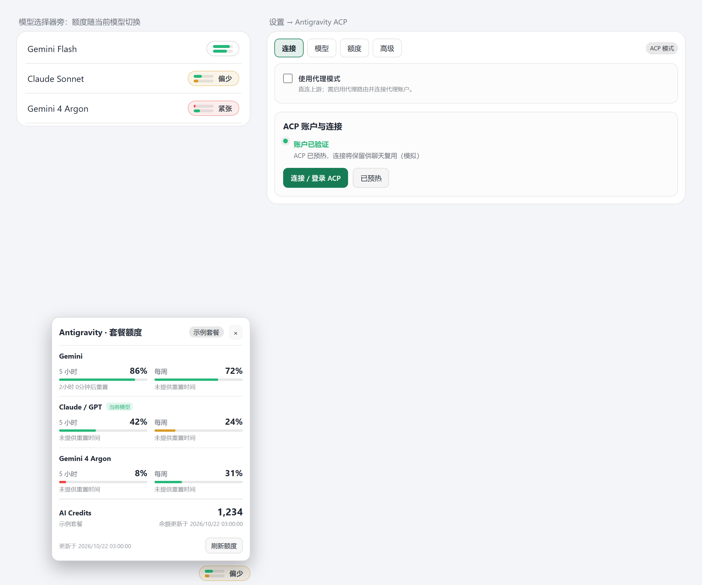
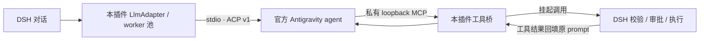

<div align="center">

# Antigravity ACP for DSH

**在 DSH 里使用 Antigravity 模型，工具仍交给 DSH。**

把 Antigravity ACP、Google AI Studio 和 Vertex AI 接入同一个 DSH 模型选择器，还可按需启用 Google Colab 工具。

[](https://www.npmjs.com/package/dsh-bundle-antigravity-host)
[](LICENSE)
[](#兼容性与验证范围)

[快速开始](#快速开始) · [选择接入方式](#选择接入方式) · [功能预览](#功能预览) · [配置参考](docs/configuration.md) · [更新记录](docs/changelog.md)



</div>

---

> **0.1.54 · 扩展 Google 接入**：新增 AI Studio 直连和本地用量、标准 Vertex AI 路由，以及可在插件页单独启停的 Colab 工具。ACP 仍是默认模式。[完整更新记录](docs/changelog.md#0154--2026-11-28)

## 快速开始

```console
dsh plugin --profile web add dsh-bundle-antigravity-host
```

`web` 是示例 Profile，请替换为实际目标。**DSH NEXT Desktop 使用目标桌面壳提供的 DSH Desktop CLI**；不要用独立 npm 公共 CLI 管理保留的 `desktop` Profile。[安装与更新说明](docs/reference.md#安装与更新)

1. **安装并启用**：按部署方式重载或重启，让 Host 与 Client 一起生效；只刷新页面不保证 Host 已升级。
2. **打开「设置 → Antigravity ACP」**：需要代理时先配置并保存，再点击 **连接 / 登录 ACP**。插件优先复用已有 ACP 登录态，或导入本机已登录的官方 CLI 登录态（含 agy ≥1.5.17 在 macOS 钥匙串中的登录态，只读取出）；必要时才进入官方浏览器授权。成功建会话后读取模型目录，不需要先发送聊天。
3. **选择模型，开始对话**：提供商名称为 **Antigravity (ACP)**，路由 ID 为 `antigravity-acp`。模型选择器左侧出现紧凑额度药丸；预热入口位于设置页，工具调用继续走 DSH 的校验、审批与执行。

使用代理模式时，启用插件页的 `antigravity-proxy-router` 组件，在设置页「运行模式」勾选并保存，再点击「连接代理账户 → 打开 Google 授权页」。**无需安装 agy CLI**，在运行 DSH 的同一台电脑上授权，账户和已有项目检测通过后自动读取模型，选择 **Antigravity（代理模式）** 的模型开始对话。组件未就绪时页面说明原因，ACP 仍保持停用；代理模式不会自动预热或启动官方进程。

**额度或 AI Credits 没有显示？** 额度查询默认不调用本机 `agy`。ACP 套餐额度走内置直连，代理模式走代理账户；AI Credits 默认不查询。只有在设置页「额度」打开「用 agy CLI 查询额度」并保存后，才会调用 `agy -p /usage` 与 `agy -p /credits`。ACP 登录成功不代表 CLI 也已登录。[登录态与数据来源](docs/reference.md#登录态与额度来源)

## 选择接入方式

| 接入 | 从哪里开启 | 使用的账号或凭据 |
|---|---|---|
| **Antigravity ACP（默认）** | 设置 → 连接 / 登录 ACP | Antigravity 官方登录态 |
| **Antigravity 代理** | 设置 → 运行模式 | 独立连接的 Google 代理账户；开启后停用 ACP |
| **Google AI Studio** | 设置 → AI Studio | Gemini API key；此 Host 的用量和限流单独显示，项目总量见 AI Studio 看板 |
| **Vertex AI** | 设置 → Vertex AI | Google Cloud 项目、区域和 ADC；支持文本流式和工具回填 |
| **Google Colab** | 插件 → Google Colab | [官方 Colab CLI 与已有 ADC](docs/colab.md)；可查 Compute Units，经审批在指定的现有运行时执行 Python / Notebook |

AI Studio 和 Vertex AI 可与 ACP 或代理模式并用。Colab 随同一个包安装，默认关闭，不注册模型；关闭它只会移除 Colab 工具。

## 功能预览

<picture>
  <source media="(prefers-color-scheme: dark)" srcset="https://raw.githubusercontent.com/KouzakiUmi/dsh-antigravity-acp/main/assets/readme/features-dark.png">
  
</picture>

左：模型选择器旁的额度药丸，展开后按额度组显示窗口与剩余百分比。右：设置页的连接状态、分阶段耗时与模型管理。画面来自当前 `src/client.js` 的真实组件，数字与套餐名均为虚构。

## 功能亮点

### 多个对话，不再共用一个待审批回合

默认按需启动最多 **2 个独立 worker**，可配置为 1–4 个。一个会话等待工具审批时，其它会话可使用空闲 worker；同一工具回合的结果仍回到原 worker。容量用满后排队，支持取消，默认等待上限 120 秒，主对话优先于排队中的后台标题。

并发 worker 共用当前链路的上游账户额度。[并发与续轮配置](docs/reference.md#并发与工具续轮)

### 先连接、拿目录，再开始聊天

设置页区分 **立即预热** 与 **连接 / 登录 ACP**：前者准备连接但不创建会话，后者验证会话并读取模型目录，两者都不发送聊天 prompt。目录使用缓存即时显示，支持主动刷新；模型列表按模型逐项控制是否出现在 DSH 选择器、默认思考档位、显示名与官方 ID 映射。

模型家族与思考强度分开：选择家族，再由 DSH 的思考强度菜单路由到官方对应档位。不硬编码账号应当拥有的模型清单。[模型与请求项映射](docs/reference.md#模型目录与请求项)

### 图片传给模型，不只传一段文字说明

在 **宿主附件服务可用且上游声明 image capability** 时，当前消息、历史消息和工具返回的图片通过真实图片内容传入。支持 PNG、JPEG、WebP 与 GIF；只读取宿主附件，不自行抓取图片 URL。已被宿主卸载的图片会明确说明未发送像素。

图片生成走独立的 `agy_image_generate` 工具，在代理模式的「高级 → 附属功能」中启用。音频、视频未接入。[图片输入](docs/reference.md#图片输入)

### 规划与执行分开

选择 `antigravity-orchestrator` 后，插件先让 planner 产出一份带步骤与交回条件的计划，再由 executor 执行；executor 遇到工具失败、同一工具连续失败两次或用户改向时停下重新规划。两个角色均可配置：planner 三选一（Neon / Argon / Opus 5.5），executor 两选一（Hydrogen / Sonnet 5.5，默认 Hydrogen，对齐官方 Antigravity 编排设置），各带思考档位。代理模式是两次独立上游请求，ACP 模式在独立 planner 会话里跑官方 `mode=plan` 再回 chat 会话切模型执行。每回合规划次数有上限，planner 失败或超时降级为单模型执行，计划只在需要时注入。[编排模式](docs/configuration.md) · [实现规格](docs/orchestrator-design.md)

### 额度、余额与连接状态，就在对话旁

- **额度药丸**：随当前模型切换对应额度组；展开查看各组的窗口、剩余百分比、重置时间与缓存状态。额度窗口短周期在上；上游额度池合并为 Gemini 与 Claude/GPT 两组，旧的独立 Argon 组并入 Gemini 展示。
- **AI Credits**：与套餐额度独立展示、独立缓存与报错；未知不是零，不会自动开启 Credits 付费回退。默认不查询，打开「用 agy CLI 查询额度」后来自官方 CLI 账户。
- **预热与诊断**：ACP 预热位于设置页；设置页集中连接、模型、完整配置与按需展开的诊断，代理登录显示准备、授权和完成阶段。
- **手动拉取额度**：设置页点击拉取，按当前模式取数并与对话药丸共享刷新结果；打开页面不自动查询。药丸采用 subusage 风格迷你条与简短状态。
- **常驻保存与草稿保护**：保存栏滚动时留在顶部，集中显示未保存计数、撤销与冲突；后台刷新保留输入，遵守只读状态。网络修改先保存再连接。

## 它如何工作



本包是 **Host + Web Client bundle**：Host 注册模型 provider、管理官方进程和工具桥，Client 提供设置页与额度药丸。`agy` CLI 用于 ACP 只读模型目录，以及显式开启「用 agy CLI 查询额度」后的额度与余额查询。Colab 官方 CLI 由同包的可选工具组件调用，不参与模型路由。

**它不是直接的 Gemini 模型 API。** 默认情况下同一 DSH 对话会复用同一个 ACP 会话，在输入前缀与上一步输出一致时，后续回合只发送新增消息，未变化的上下文去重，变化内容仍发送，历史由官方 agent 自己持有；历史被压缩、回退或编辑，或模型、系统提示、工具目录变化时自动重建会话并全量重放一次（`reuseSessions=false` 可回到每轮重放）。工具续轮仍在同一个 prompt 内完成。角色消息、采样控制、延迟与计费不能视为和原生 API 相同。

## 使用前，先知道这些边界

| 边界 | 当前行为 |
|---|---|
| 工具与权限 | AGY 内置工具、ACP fs / terminal 关闭；只允许已识别的私有桥请求进入 DSH，`allow_once` 不等于绕过 DSH 审批。协议约束**不是 OS 沙箱**。 |
| 登录材料 | 插件可能读取 CLI 登录文件与 macOS 钥匙串条目（均只读），并为官方 ACP 写入 / 更新本机凭据文件；这些文件不是加密凭据库，Windows 访问保护依赖目录 ACL。 |
| 官方程序 | 按需从 `https://dl.google.com` 下载，拒绝重定向并检查 ZIP 路径；官方未提供校验和，不宣称签名验证通过。默认 server 版本为 **1.5.2**，不跟随 registry 自动升级。 |
| 模型参数 | `reasoningEffort` 映射官方档位；`maxTokens` 忽略；显式 `temperature` / `stop` 记录警告并忽略，值不生效。 |
| 数据可信度 | 缓存、失败、缺字段和未知分别标记；额度与余额是上游快照数据，不是计费数据。 |
| 版本与测试 | 宽 peer 范围是安装条件，不是全部 Core / 平台版本实机兼容证明；隔离测试不替代真实账号与 GUI 验收。 |

## 兼容性与验证范围

| 项目 | 当前声明 / 证据 |
|---|---|
| Node.js | `>=22.19` |
| DSH Core peer 范围 | `>=0.2.0-rc.1 <0.2.1-0 \|\| >=0.2.1-0 <0.3.0-0 \|\| >=0.2.2-0 <0.3.0-0`，适用于所声明的三个 `dsh-*` peer；npm 与 DSH 分别检查准入 |
| Cordis peer 范围 | `~4.1.0` |
| 开发契约基准 | `dsh-llm` / `dsh-subprocess` / `dsh-typert-protocol` / `dsh-attachment` **0.2.2-rc.3**，Cordis **4.1.0**（与实机内嵌版本一致，类型检查在该基准下运行） |
| 上游协议 | ACP **v1**；SDK **1.4.0** 与默认 server **1.5.2** 是两个独立版本 |
| 0.1.54 本地验证 | 类型检查、68 个测试文件（1129 项通过、1 项跳过）和构建。 |
| 桌面组件验证 | DSH NEXT **2.0.24-next** / Core **0.2.2-rc.5**：隔离验证了模型路由并存、Typert 注册与清理、Colab 工具注册和停用，以及无审批渠道时拒绝执行。 |
| 待实机验收 | 完整 Desktop GUI、真实 Vertex AI 生成、Colab 账号余额和 Notebook 执行。已有 AI Studio 上游验证见[技术记录](docs/aistudio-provider-design.md#11-真实-key-探针核实结论2026-11-27)。 |

宿主附件服务是可选依赖，缺少时仍可文本聊天。npm 对照已解析的依赖版本检查 peer；本包未声明 `engines.dsh`，DSH 对照自身 Core 版本检查 `dsh-*` peer，并让预发布版本参与范围匹配。路由、服务与客户端装载另行验证。[完整声明与验证方法](docs/development.md)

## 文档导航

| 你想做什么 | 文档 |
|---|---|
| 安装、连接、查看额度或排查错误 | [使用与技术参考](docs/reference.md) |
| 调整并发、超时、模型、代理或二进制位置 | [完整配置与环境变量](docs/configuration.md) |
| 启用 Colab、查询 Compute Units 或运行 Notebook | [Colab 工具使用说明](docs/colab.md) |
| 查看各版本更新、迁移注意与剩余限制 | [更新记录](docs/changelog.md) |
| 构建、测试、打包或维护 npm 发布流程 | [开发、验证与发布](docs/development.md) |

## 许可与反馈

本插件采用 [MIT License](LICENSE)。Antigravity 官方程序和 Colab CLI 均独立获取，不随包分发。

遇到问题请[提交 Issue](https://github.com/KouzakiUmi/dsh-antigravity-acp/issues)，附插件版本、**实际 DSH Core 版本**、操作系统、操作步骤和已脱敏错误码。不要附 token、Cookie、完整 OAuth URL、代理密码或凭据文件。
